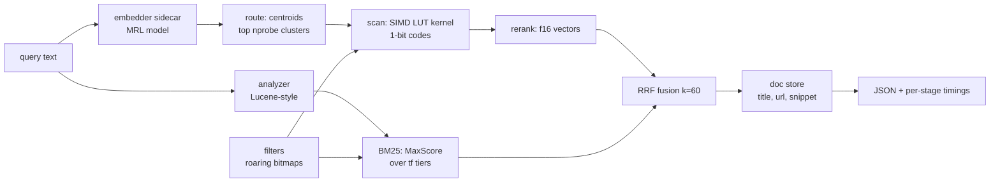

# telusur: Product Requirements Document

**Owner:** Austin Gabriel Pardosi **Status:** Draft v1, 5 Nov 2026 **Type:** personal project **Build tool:** Claude Code in VS Code (see [`CLAUDE.md`](CLAUDE.md))

---

## 1. One line

**telusur** is a hybrid search engine in Rust that rebuilds the architecture Exa describes in its engineering blog: a binary-quantized Matryoshka vector index with register-resident lookup-table scoring, a compressed in-memory BM25 index, and rank fusion on top, all measured honestly on real datasets.

**Name:** *telusur* is Indonesian for "to search through, to trace" (teh-LOO-soor). It is short, means exactly what the project does, and has a personal story behind it. It is free on [crates.io](http://crates.io) as of 5 Nov 2026, so the crate, repo and CLI can all be `telusur`. My first pick, `cari` ("search"), is already taken on [crates.io](http://crates.io) by an unrelated package. Backups that were also free: `lacak` ("to track"), `jelajah` ("to explore").

## 2. Why this project

I want to understand how a search engine built for AI works under the hood, end to end. telusur is a small, honest version of a web-scale vector DB and keyword index, plus the pipeline around them.


| Goal                                               | telusur shows it with                                                            |
| -------------------------------------------------- | -------------------------------------------------------------------------------- |
| High-throughput, low-latency systems               | SIMD scoring kernels, p50/p99 latency and QPS for every benchmark                |
| Pipelines over millions of docs per day            | Rust ingest pipeline over FineWeb, reported as docs/sec and docs/day             |
| Optimizing one system deeply                       | Per-kernel throughput, memory per vector, per-stage timing, ablations            |
| Information quality                                | BM25 parity with Lucene on BEIR, nDCG@10 for keyword vs neural vs hybrid         |
| Systems Rust                                       | The whole engine is Rust, including the kernel the reference design wrote in C++ |
| A vector DB designed for a billion vectors, 100 ms | Same design at 1M scale on one machine, with memory math for scaling out         |
| Web-scale keyword search                           | Compressed BM25 with pruning, millions of docs                                   |


The detail that started it: Exa's vector DB post says the lookup-table kernel had to be written in C++ instead of Rust for performance. telusur does it in Rust with `std::arch` (AVX2, AVX-512, NEON) and shows the numbers.

## 3. The blueprint: what Exa has published

Everything below comes from Exa's own posts. telusur follows these designs on purpose, so every result can be checked against what the posts report.

**Vector DB** ([How we built a web-scale vector database](https://exa.ai/blog/building-web-scale-vector-db), Dec 2024)

- Requirements: billions of vectors (4096 dims), metadata filters, under 100 ms, over 500 QPS.
- Matryoshka embeddings truncated to the first 256 dims.
- Binary quantization: each dim becomes 1 bit (+1 / -1).
- Asymmetric scoring: binary documents, but the query stays in float. Dot product, not Hamming distance (they found Hamming lossy).
- Lookup tables: split into groups of 4 dims (the post calls them subvectors; 8 also works). For each query subvector, precompute all 16 possible dot products with a binary document subvector. Scoring is then one lookup per 4 dims.
- Tables kept in CPU registers. Footnote: this part was written in C++ instead of Rust.
- IVF clustering: 100,000 clusters; search only the nearest ones. Roughly 1000x throughput for little recall loss.
- Rerank the top candidates with uncompressed vectors.
- Filters through inverted indexes (value to doc id list); search only runs over matching docs. They note clustering composes with filters better than HNSW, and shards more easily.

**BM25** ([Serving BM25 with 50% memory reduction](https://exa.ai/blog/bm25-optimization), May 2025)

- Rust, in-memory inverted index, billions of docs sharded across workers. Started at over 1.8 TB per billion docs.
- Tricks: group postings by term frequency (tf stored once per group; telusur calls these tiers), delta + varint doc ids (about 1.3 bytes per id instead of 4), zstd on top, one flat buffer with `(offset, len)` per term instead of one `Vec` per term, singletons stored inline, +1-shifted ids so 0x00 can be a separator.
- Query: start from the rarest terms, WAND-inspired pruning. Result: over 50% less memory, about 10% lower latency.

**Pipeline** ([Composing a search engine](https://exa.ai/blog/composing-a-search-engine))

- Search is a DAG of nodes: query encoding, sharded ANN workers, scorers, rerankers, content fetch.
- Example fusion node: reciprocal rank fusion (RRF) with `k = 60` over neural and keyword sources.
- Automatic tracing at every node boundary (timings, inputs, decisions).

**Data** ([exa-d, storing the web in S3](https://exa.ai/engineering))

- Lance columnar format on S3, typed columns, a dependency graph between columns, Ray Data for execution, recompute only missing columns.

## 4. Goals and non-goals

### Goals

1. A working engine: index a corpus, search it over HTTP in keyword, neural or hybrid mode, with filters.
2. Faithful to Exa's published design, with each deviation explained.
3. Every claim backed by a reproducible benchmark and the exact command that produced it.
4. Correctness first: every fast path is tested against a slow exact path.
5. Runs on one laptop (Apple Silicon or x86), tested in CI on both architectures.

### Non-goals

- Billion scale. We show the design at 1M to a few million docs and do the memory math for more.
- Training embedding models. We use open MRL models and one precomputed OpenAI set.
- A crawler. It is hard to benchmark fairly and less interesting than the index. Ingest starts from FineWeb (already crawled and cleaned).
- Distributed serving. One process, sharding described in the README as next steps.
- A pretty UI. A tiny demo page is a stretch goal only.

## 5. Success metrics (targets, not claims)

Measure first, then write the README. These are the bars to aim for.


| Area             | Metric                                             | Target                                                      |
| ---------------- | -------------------------------------------------- | ----------------------------------------------------------- |
| Kernel           | Codes scored per second per core, 256-dim codes    | ≥ 400M on AVX2 or NEON, ≥ 20x the scalar kernel             |
| Kernel           | Agreement with scalar reference                    | Bit-for-bit, all dims 64 to 1024                            |
| ANN (DBpedia 1M) | Recall@10 vs rerank ground truth                   | ≥ 0.95 at p50 ≤ 5 ms, single thread                         |
| ANN              | Recall@10 vs full ground truth (3072 dims)         | Report it (end-to-end loss from truncation)                 |
| ANN              | Hot memory per vector                              | ≤ 40 bytes (32 B code + 4 B id + padding)                   |
| Filters          | Results that violate the filter                    | 0                                                           |
| Filters          | Latency at 1% selectivity                          | ≤ 2x unfiltered                                             |
| BM25 quality     | nDCG@10 on SciFact, NFCorpus, FiQA, TREC-COVID     | Within 1.0 point of Anserini BM25 (k1=0.9, b=0.4)           |
| BM25 pruning     | MaxScore top-k vs exhaustive                       | Same top-k scores on every query, within 1e-5 relative      |
| BM25 pruning     | Postings decoded                                   | ≥ 50% fewer than exhaustive on 3+ term queries              |
| BM25 memory      | Index size vs naive `HashMap<u32, Vec<(u32,u32)>>` | ≥ 50% smaller (Exa's number)                                |
| Hybrid           | RRF nDCG@10                                        | ≥ the better of keyword and neural on 3 of 4 BEIR sets      |
| Ingest           | End-to-end docs/sec on FineWeb                     | Report, plus docs/day = docs/sec × 86,400                   |


**Calibration:** during research a throwaway prototype of the scoring kernel (not part of this pack) ran on a 2 vCPU Intel Xeon 2.1 GHz cloud VM, 256-dim codes, one cluster of 65,536 codes: scalar about 19M codes/s, AVX2 about 460M codes/s, AVX-512 about 550M codes/s, single core. So the kernel target is realistic, and a 50k-code scan is roughly 0.1 ms.

## 6. Architecture



One process. Keyword and neural retrieval run in parallel (`rayon::join`), then fuse. Every stage records its time, like Exa's tracing.

An index is read-only once built: no add, update or delete, and changing the corpus means a rebuild ([ADR 0001](docs/adr/0001-indexes-are-immutable.md)). Words like cluster, code, tier and rerank depth are defined in [`GLOSSARY.md`](GLOSSARY.md).

### 6.1 Vector index

**Inputs:** N full vectors of D dims (any MRL model), stored as `.fbin`, one row per doc. Every doc in an index has a vector, or none do: if `--vectors` is given, its row count must equal the doc count or the build fails. Without `--vectors` the index is keyword-only.

**Build**

1. Matryoshka prefix: first `d_code` dims (default 256), L2 normalize.
2. Train spherical k-means on a sample (64 points per cluster) of the prefixes. `nlist` (the number of clusters, FAISS's name) default ≈ 2·√N rounded to a power of two (2048 for 1M). Random init, reseed empty clusters, about 12 iterations.
3. Assign every vector to its nearest centroid. Use a real GEMM (`matrixmultiply::sgemm`) in row chunks; a naive dot loop is far too slow at 1M × 2048.
4. Binarize the prefix: bit = 1 if value > 0. Byte j holds dims 8j to 8j+7, least significant bit first. So the low nibble of byte j is group 2j and the high nibble is group 2j+1.
5. Lay clusters out contiguously. Each cluster is padded to whole blocks of 32 docs. Padding slots get id `u32::MAX`.
6. Fast-scan block layout: within a block, transpose so row j is byte j of all 32 codes (32 bytes). One load gives a nibble of 32 docs, which is the shape a shuffle wants.
7. Rerank vectors: first `d_rerank` dims (default the smaller of 1024 and D), normalized, as f16, in doc id order, memory-mapped.

**Per-query lookup table**

- For each group g of 4 query dims and each 4-bit pattern n: `lut[g][n] = Σ_k (bit k of n ? q[4g+k] : -q[4g+k])`.
- Quantize to u8 per query: subtract each group's minimum (`-Σ|q|` over the 4 dims), multiply by one global `scale = 255 / max group range`. Ranking is preserved; the constant offset is dropped.
- Accumulate in u16. Max sum is groups × 255, which fits for up to 1024 dims (256 × 255 = 65,280).

**Kernels** (runtime dispatch, override per process with env `TELUSUR_KERNEL=scalar|avx2|avx512|neon` or per request with a debug option)

- *Scalar:* reference. Also used in tests.
- *AVX2:* per row, `and` / `srli_epi16` to split nibbles, two `vpshufb` lookups. `pshufb` works inside each 128-bit lane, so each 16-byte table is duplicated into both lanes. Widen to u16 by treating the register as 16 u16 lanes: `x & 0x00FF` is even docs, `x >> 8` is odd docs.
- *AVX-512BW:* two rows per iteration. Table register holds `[g(4p), g(4p), g(4p+2), g(4p+2)]` for low nibbles and `[g(4p+1), .., g(4p+3), ..]` for high nibbles. Fold the two 256-bit halves at the end.
- *NEON:* `vqtbl1q_u8` is the 16-entry lookup; `vaddl_u8` / `vaddl_high_u8` widen into u16 in natural doc order.

**Search**

1. Route: dot product of the query prefix with every centroid, keep the best `nprobe` clusters, scan best first so the threshold rises early.
2. Scan: kernel scores each cluster into a u16 buffer; keep the top rerank depth candidates (default 500, from B3: at 200 recall stops near 0.92 on DBpedia) with a threshold check before touching the heap.
3. Rerank: exact dot product with rerank vectors; return top k. The query can arrive as a full vector; it is truncated and normalized first.
4. Filters: a roaring bitmap of allowed ids. If it allows ≤ 20,000 docs, skip the index and score those docs exactly with rerank vectors (this is Exa's "only search the docs that match"). Otherwise scan with `nprobe / selectivity` clusters (capped) and drop disallowed ids before the heap.

**Memory per vector (1M, 256-dim codes, 1024-dim rerank)**


| Part                                  | Bytes per vector | 1M vectors |
| ------------------------------------- | ---------------- | ---------- |
| Binary code (hot)                     | 32               | 32 MB      |
| Doc id in cluster (hot)               | 4                | 4 MB       |
| f16 rerank vector (mmap, cold)        | 2048             | 2 GB       |
| Raw float32 3072-dim (for comparison) | 12,288           | 12.3 GB    |


The scan touches only the hot part. At a billion vectors the hot part is about 36 GB, which is the "less memory than a gaming PC" point from Exa's post (they also shard by cluster).

### 6.2 BM25 index

**Analyzer** (match Anserini so numbers are comparable)

- Indexed text is the title and the text joined by a newline, as one field, like Anserini's BEIR flat indexes.
- Same chain as Anserini's `DefaultEnglishAnalyzer`: split on Unicode word boundaries (UAX #29, the `unicode-segmentation` crate, matching Lucene's `StandardTokenizer`) and keep segments that contain a letter or digit, drop English possessive `'s`, lowercase, drop Lucene's 33 English stopwords, then the original Porter stemmer (Lucene's `PorterStemFilter`). Max token length matches `StandardTokenizer`'s default.
- The Porter stemmer is hand-written and tested against Porter's official word list. Not `rust-stemmers`: its only English stemmer is Snowball English (Porter2), a different algorithm.
- Queries go through the same analyzer.
- Doc length = tokens kept. Store it as one byte with Lucene's `SmallFloat.intToByte4` (exact below 24, then 4 significant bits). This is what Lucene scores with, so it is needed for parity.

**Scoring**

- Lucene BM25: `idf = ln(1 + (N - df + 0.5) / (df + 0.5))`, `score = idf · tf / (tf + k1 · (1 - b + b · dl / avgdl))`. Defaults k1 = 0.9, b = 0.4 (Anserini's BEIR settings).

**Postings format** (Exa's tricks, one change)

- Group by tf: tiers for tf = 1..15, plus an overflow tier (tf ≥ 16) that stores tf per doc.
- Delta + varint doc ids inside each tier. First value is `doc + 1`, so every varint is ≥ 1 and never contains a 0x00 byte (Exa's property).
- One flat `postings.bin`; each term has `(offset, len, df)`.
- Singletons (df = 1): doc id and tf live in the term entry, zero posting bytes.
- Term dictionary: an FST (`fst` crate), memory-mapped.
- **Change from Exa:** instead of 0x00 separators, each tier has a tiny header (`n_docs`, `byte_len`, `min_norm`, optional `max_tf`, optional skip index). Pruning needs to jump straight to any tier, which separators do not allow.
- Skip intervals of 128 postings inside long tiers. Each skip entry is `(prev_doc, byte_offset)`, so decoding can resume mid-tier.

Term layout:

```
u16  tier bitset   bit t (1..15) = tier tf==t present, bit 0 = overflow tier
u8   flags         bit 0 = has skips
u32  skip base     index into skips.bin
per tier: varint n_docs, varint byte_len, u8 min_norm,
          [varint max_tf]    overflow tier only
          [varint skip_rel]  if n_docs > 128
          data               n_docs × (varint doc_delta [, varint tf])

```

**Query: the key idea** A tier holds docs with the same tf, so its best possible contribution is exact: `idf · tf / (tf + K(shortest doc in tier))`. So grouping by frequency, which Exa did to save memory, also turns every posting list into impact-ordered sub-lists for free.

- Both strategies are selectable per request (a debug-only option), and must return the same top-k scores within 1e-5 relative. They sum per-term scores in different orders, so exact f32 equality is not promised.
- *Exhaustive (baseline):* decode every posting of every query term into a dense f32 accumulator, take top k.
- *MaxScore over tiers (main path):* treat each (term, tier) as its own cursor with its own upper bound. Sort cursors by bound. Cursors whose summed bounds cannot beat the current k-th score become "non-essential": only probed with skip intervals for docs that could still make it. The long tf=1 tiers of common words are exactly the ones that go non-essential.
- Per query, precompute a 256-entry table per tier (one entry per norm byte), so scoring a posting is one lookup.

**Memory ablation to report** (like Exa's post, step by step)

1. Naive: `HashMap<u32, Vec<(u32, u32)>>` (8 B per posting + about 33 B per term) + 4 B per doc length.
2. Flat buffer + `(offset, len)` per term.
3. Add delta varint doc ids.
4. Add tf tiers.
5. Add inline singletons, FST dictionary, 1-byte norms.
6. Optional: add zstd on cold terms (Exa does this; measure the latency cost).

### 6.3 Hybrid and pipeline

- Modes: `keyword`, `neural`, `hybrid` (default).
- Hybrid: run both retrievers in parallel for the top max(k, 100) each, fuse with RRF, `score = Σ 1 / (60 + rank)`. Ties go to the smaller doc id.
- When neural search is not possible (the index has no vectors, no embedder is configured, the embedder errors, or it does not answer within 1 s), `hybrid` falls back to keyword and says so with `mode_used` and `fallback_reason`. An explicit `neural` request fails instead (HTTP 503 for embedder problems).
- Both retrievers take the same filter bitmap.
- Response carries per-stage timings: `embed`, `route`, `scan`, `rerank`, `keyword`, `fuse`, `docs`, `total`.
- Stretch: express the pipeline as a small DAG config (like Exa's Canon) so a request can choose stages.

### 6.4 Ingest pipeline

- Read FineWeb parquet shards with the `parquet` / `arrow` crates, streaming.
- Normalize text: collapse whitespace, cut at 100,000 characters, and count the docs that were cut.
- `domain` from `url`: the host, lowercased, with any leading `www.` removed, parsed by hand (no URL crate). Subdomains are distinct domains.
- FineWeb's `date` is the crawl date, not the publish date, so it is written as `crawl_date`. FineWeb's `id` is the external id. FineWeb has no title, so title is empty.
- Dedup: exact 64-bit hash of the normalized text with the standard library hasher (no xxh3 crate), first occurrence kept. At about 15M docs a collision is about a 1 in 160,000 chance. Switch hashers only if B11 shows hashing matters. Stretch: 64-bit SimHash near-dup detection.
- Can stop after the first N docs (see D3).
- Write `corpus.jsonl` (or build the BM25 index directly).
- Report docs/sec per stage and end to end, and docs/day.

### 6.5 HTTP API

`POST /search`

```json
{
  "query": "rust simd lookup table",
  "mode": "hybrid",
  "k": 10,
  "filters": { "domain": ["arxiv.org", "github.com"], "crawl_date": { "gte": "2023-01-01", "lte": "2025-12-31" } },
  "vector": null,
  "debug": true
}

```

Response

```json
{
  "mode_used": "hybrid",
  "results": [
    { "id": "doc_123", "score": 0.0325, "title": "...", "url": "...", "snippet": "...",
      "ranks": { "keyword": 3, "neural": 1 } }
  ],
  "timings_ms": { "embed": 4.1, "route": 0.1, "scan": 0.3, "rerank": 0.2, "keyword": 0.9, "fuse": 0.01, "total": 5.8 },
  "stats": { "clusters_probed": 32, "codes_scanned": 15872, "postings_decoded": 4210 }
}

```

- `id` is the doc's external id. Doc ids never leave the engine.
- `timings_ms` is always present. `stats` only appears when `debug` is true.
- `k` above 1000 is rejected with 400.
- On fallback (see 6.3), `mode_used` is `keyword` and `fallback_reason` is one of `no_vectors`, `no_embedder`, `embedder_error`, `embedder_timeout`.
- Filters: values for one field are alternatives, different fields must all hold, and a doc missing a filtered field never matches. `crawl_date` takes inclusive `YYYY-MM-DD` bounds in whole UTC days. Filters are keyword fields and one crawl date field only, no numeric filters.
- No auth or rate limiting, so `serve` listens on `127.0.0.1:8080` by default.

Also `GET /health` and `GET /stats` (index sizes, kernel in use, doc count).

Query embedding: the server calls an embedder sidecar (`scripts/embed_server.py`, same model used to embed the corpus) at a configurable URL with a 1 s timeout, or accepts `vector` directly. This mirrors Exa's separate query-encoder workers.

### 6.6 CLI

```
telusur synth vectors|text ...           synthetic data for CI and quick benches
telusur gt --base --queries --k 100      exact ground truth (sgemm, chunked)
telusur index --corpus corpus.jsonl [--vectors base.fbin] --out idx/
              [--d-code 256] [--d-rerank 1024] [--nlist auto] [--keyword-fields domain] [--date-field crawl_date]
telusur bench kernels | ann | filters | bm25 | ablate-quant | ablate-postings
telusur eval beir --data data/scifact --index idx/ [--query-vectors q.fbin]
telusur ingest fineweb --parquet data/fineweb/ --out corpus.jsonl
telusur search --index idx/ "query"
telusur serve --index idx/ --addr 127.0.0.1:8080 --embedder http://127.0.0.1:8001

```

## 7. Datasets

All data lives in `data/` (gitignored). Scripts in `scripts/` download and convert.

### D1. DBpedia 1M with OpenAI text-embedding-3-large (main ANN benchmark)

- **Source:** [`Qdrant/dbpedia-entities-openai3-text-embedding-3-large-3072-1M`](https://huggingface.co/datasets/Qdrant/dbpedia-entities-openai3-text-embedding-3-large-3072-1M) on Hugging Face.
- **Size:** 24.8 GB, about 1M rows, 3072-dim vectors plus title and text.
- **Why:** real, large, and the model supports Matryoshka truncation, which is exactly Exa's setup. It also has text, so BM25 and hybrid can run on the same corpus.
- **Prep (**`scripts/prep_dbpedia.py`**):** auto-detect the embedding column (the dataset card does not list columns clearly), hold out the last 1,000 rows as queries, write `base.fbin` (999,000 × 3072), `queries.fbin`, `corpus.jsonl`. Then `telusur gt` for the exact top 100 at full 3072 dims (full ground truth) and at the rerank dims (rerank ground truth).
- **Note:** BEIR's DBPedia-entity qrels are for the full 4.6M corpus, so do not use them for quality on this 1M subset. D1 is for speed, memory and recall only.
- **Disk:** about 12 GB for `base.fbin` at full dims. After prep and both ground truths, delete the 24.8 GB parquet download and keep the full-dim `base.fbin`, so full-dim rerank stays possible.

### D2. BEIR (retrieval quality)

- **Source:** [`https://public.ukp.informatik.tu-darmstadt.de/thakur/BEIR/datasets/{name}.zip`](https://public.ukp.informatik.tu-darmstadt.de/thakur/BEIR/datasets/{name}.zip), or `BeIR/{name}` on Hugging Face. Format: `corpus.jsonl`, `queries.jsonl`, `qrels/test.tsv`.
- **Sets:**


| Dataset                    | Docs      | Test queries | Anserini BM25 nDCG@10 | Anserini BM25 R@100 |
| -------------------------- | --------- | ------------ | --------------------- | ------------------- |
| SciFact                    | 5,183     | 300          | 67.89                 | 92.53               |
| NFCorpus                   | 3,633     | 323          | 32.18                 | 24.57               |
| FiQA                       | 57,638    | 648          | 23.61                 | 53.95               |
| TREC-COVID                 | 171,332   | 50           | 59.47                 | 10.91               |
| NQ (scale, optional)       | 2,681,468 | 3,452        | 30.55                 | 75.13               |
| MS MARCO (scale, optional) | 8,841,823 | 6,980 (dev)  | n/a (memory only)     | n/a                 |


Reference scores are Anserini's BEIR (v1.0.0) flat BM25 regressions, k1=0.9, b=0.4 ([SciFact](https://github.com/castorini/anserini/blob/master/docs/reproduce/from-document-collection/beir-v1.0.0-scifact.flat.md), [NFCorpus](https://github.com/castorini/anserini/blob/master/docs/reproduce/from-document-collection/beir-v1.0.0-nfcorpus.flat.md), [FiQA](https://github.com/castorini/anserini/blob/master/docs/reproduce/from-document-collection/beir-v1.0.0-fiqa.flat.md), [TREC-COVID](https://github.com/castorini/anserini/blob/master/docs/reproduce/from-document-collection/beir-v1.0.0-trec-covid.flat.md), [NQ](https://github.com/castorini/anserini/blob/master/docs/reproduce/from-document-collection/beir-v1.0.0-nq.flat.md)). Anserini has no BEIR flat regression for MS MARCO, so it is used for memory (B8) only. bm25-benchmarks was the first choice, but it does not say how its numbers were made.

To compare like with like, `telusur eval beir` does what those regressions do:

- Index title and text as one field (see 6.2).
- Drop results whose doc id equals the query id (Anserini's `-removeQuery`).
- Score with trec_eval's rules: the relevance grade is the gain, ties are ordered the way trec_eval orders them, and the average covers every query in the qrels (`trec_eval -c`). Checked once against `pytrec_eval`.

[bm25-benchmarks](https://github.com/xhluca/bm25-benchmarks) still has single-core QPS for PISA, BM25S, Elasticsearch and Pyserini, useful context (different hardware, so label it as such).

- **Embeddings (**`scripts/prep_beir.py`**):** embed corpus and queries with the default model below (with its `search_document:` / `search_query:` prefixes), write `corpus.fbin`, `queries.fbin`, `query_ids.txt`.

### D3. FineWeb sample-10BT (ingest pipeline and web-style filters)

- **Source:** [`HuggingFaceFW/fineweb`](https://huggingface.co/datasets/HuggingFaceFW/fineweb), config `sample-10BT`.
- **Size:** about 10B GPT-2 tokens, 27.6 GB parquet. Exact doc count: log it during ingest.
- **Columns:** `text, id, dump, url, date, file_path, language, language_score, token_count`. `url` gives domain filters. `date` is the crawl date ("crawl date (from CommonCrawl)" on the dataset card), not the publish date, so ingest writes it as `crawl_date` and it gives crawl date range filters.
- **License:** ODC-By 1.0, plus Common Crawl terms of use. Credit it in the README.
- **Use:** ingest throughput, BM25 at multi-million scale, filter benchmarks.
- **Scale:** the whole sample (about 15M docs, roughly 40 GB of text) does not fit the laptop (16 GB RAM, 68 GB free disk) next to D1, and a keyword build of all of it would need a segment-and-merge build. So ingest and index only the first N docs, picking N after measuring a 1M-doc build (likely 3M to 5M). Download only the parquet files needed for N docs. The README states N and why.
- **Neural:** the first 1M docs of the deduplicated corpus are embedded and built as their own full index, since every doc in an index has a vector or none do. Embedding all of it on a laptop takes too long.

### D4. Synthetic (CI, no downloads)

- Vectors: two-level Gaussian mixture with per-dim variance decaying with index (Matryoshka-like), normalized.
- Text: Zipfian vocabulary with topical words, plus 2 to 4 term queries mixing one common and several topical words.
- Used only for tests and quick speed checks. Never quote synthetic numbers as quality results.

### Embedding models


| Model                                                                                                  | Params | Dims | Matryoshka        | Notes                                                                                                                   |
| ------------------------------------------------------------------------------------------------------ | ------ | ---- | ----------------- | ----------------------------------------------------------------------------------------------------------------------- |
| [nomic-embed-text-v1.5](https://huggingface.co/nomic-ai/nomic-embed-text-v1.5) (default)               | 0.1B   | 768  | 512, 256, 128, 64 | Prefixes `search_document:` and `search_query:` . Apache 2.0. MTEB 62.28 at 768, 61.04 at 256                           |
| [mxbai-embed-large-v1](https://huggingface.co/mixedbread-ai/mxbai-embed-large-v1) (quality comparison) | 0.3B   | 1024 | yes               | Built for binary quantization too. Query prompt `Represent this sentence for searching relevant passages:` . Apache 2.0 |
| OpenAI text-embedding-3-large                                                                          | n/a    | 3072 | yes               | Only through D1, precomputed. No API key needed                                                                         |


### File formats

- `.fbin`: `u32 n, u32 d`, then `n × d` f32, little endian (big-ann-benchmarks format).
- `.ibin`: `u32 n, u32 k`, then `n × k` u32 ids (ground truth).
- `corpus.jsonl`: one object per line: `id` (or BEIR `_id`), `title`, `text`, plus any filter fields (`domain`, `crawl_date`, ...). Line order = doc id = row in `base.fbin`. `id` / `_id` is the external id, the only id the API returns.

## 8. Benchmarks and evaluation

**Rules**

- Always print hardware (CPU model, cores, RAM, OS) and the kernel used.
- Release build, warm cache (one warm-up pass), `target-cpu=native`.
- Latency: single thread on a performance core (high QoS on macOS), 1,000+ queries, report p50, p99, mean. Throughput: report QPS at 4 threads (performance cores only) and 10 threads (all cores) on the M4.
- Every README table names the command that made it.
- Same machine for every comparison against another engine.
- Machines: an Apple M4 laptop (4 performance + 6 efficiency cores, 16 GB RAM) runs every benchmark. A short-lived x86 cloud VM with AVX-512 (Sapphire Rapids class, for example AWS `c7i` or GCP `c3`) runs B1's AVX2 and AVX-512 rows and the full test suite. Every table names its machine.

**Tables to produce**


| ID  | Benchmark                   | Dataset                                      | Output                                                                                   |
| --- | --------------------------- | -------------------------------------------- | ---------------------------------------------------------------------------------------- |
| B1  | Kernel throughput           | synthetic codes, 256 and 512 dims            | codes/s and GB/s per kernel (criterion)                                                  |
| B2  | First-stage scorer ablation | D1 (200k subset)                             | recall@100 of Hamming vs asymmetric float vs asymmetric u8 LUT, at 64/128/256/512 dims   |
| B3  | ANN Pareto                  | D1                                           | recall@10 vs latency for nprobe ∈ {8,16,32,64,128} × rerank depth ∈ {0,100,200,500}      |
| B4  | ANN vs others               | D1                                           | FAISS `IndexIVFFlat`, `IndexBinaryIVF`, HNSW (hnswlib) at matched recall: QPS and memory |
| B5  | Filters                     | D1 with synthetic categories, D3 domain/crawl date | latency and recall at 0.1%, 1%, 10%, 50% selectivity                                     |
| B6  | BM25 parity                 | D2                                           | nDCG@10, Recall@100 vs Anserini reference                                                |
| B7  | BM25 pruning                | D2 + D3                                      | exhaustive vs MaxScore-over-tiers: postings decoded, p50/p99, QPS, identical results     |
| B8  | BM25 memory                 | D3 (and D2 NQ / MS MARCO)                    | the step-by-step ablation from 6.2                                                       |
| B9  | BM25 vs Tantivy             | D2 + D3                                      | QPS and index size, same machine                                                         |
| B10 | Hybrid quality              | D2                                           | nDCG@10 for keyword, neural, hybrid                                                      |
| B11 | Ingest                      | D3                                           | docs/s per stage, end to end, docs/day                                                   |
| B12 | End-to-end API              | D1 or D3                                     | HTTP p50/p99 per mode, with per-stage split                                              |


How B4 and B9 run (the FAISS, hnswlib and Tantivy harnesses) is decided in M6. Tantivy goes in its own crate, so it never enters telusur's dependency list.

**Expected headline findings** (verify, do not assume)

1. The register LUT kernel in Rust: hundreds of millions of codes per second per core, tens of times faster than scalar.
2. Asymmetric scoring beats Hamming on first-stage recall at the same memory (Exa's claim, tested on open data).
3. Frequency tiers are impact tiers: MaxScore over tiers decodes far fewer postings with the same top-k scores.
4. BM25 matches Anserini within a point on BEIR while using less than half the naive memory.

## 9. Milestones

About 4 weeks. M1 to M3 alone is already a strong project; ship those first.


| #   | Milestone                                                               | Days | Done when                                                                                                     |
| --- | ----------------------------------------------------------------------- | ---- | ------------------------------------------------------------------------------------------------------------- |
| M0  | Repo, CI (ubuntu x86 + macos arm64), lint                               | 1    | CI green on both runners                                                                                      |
| M1  | Quantization + LUT + 4 kernels + criterion bench                        | 3    | Kernels match scalar bit-for-bit for dims 64 to 1024 incl. ragged blocks and the overflow edge case; B1 table |
| M2  | k-means, IVF build/search, f16 rerank, ground truth, ANN bench, D1 prep | 4    | B2 and B3 on D1; recall target met or the gap explained                                                       |
| M3  | Analyzer, postings, exhaustive + MaxScore, BEIR eval                    | 5    | B6 within 1 point; MaxScore = exhaustive on all queries; B7, B8                                               |
| M4  | Filters, doc store, hybrid RRF, HTTP server, embedder sidecar           | 3    | B5, B10, B12; `curl` demo in README                                                                           |
| M5  | FineWeb ingest pipeline + domain/crawl date filters at scale            | 3    | B11; BM25 on millions of FineWeb docs                                                                         |
| M6  | Comparisons (FAISS, Tantivy), README results, blog post, demo GIF       | 3    | B4, B9; README has no TBD left                                                                                |


**Tickets:** the milestones are broken into GitHub issues under [#1](https://github.com/AustinPardosi/telusur/issues/1) (one per session, blockers first). Work those instead of this table.

## 10. Repo layout

```
telusur/
├── Cargo.toml
├── .cargo/config.toml          target-cpu=native
├── CLAUDE.md  PRD.md  README.md  GLOSSARY.md  LICENSE
├── docs/                       adr/ (decisions), agents/ (agent skill config)
├── assets/                     social preview (also the README banner)
├── src/
│   ├── lib.rs
│   ├── util.rs                 mmap arrays, fbin/ibin, TopK, percentiles
│   ├── vector/                 quant.rs kernel.rs kmeans.rs ivf.rs
│   ├── text/                   analyzer.rs codec.rs index.rs
│   ├── filter.rs  docstore.rs  engine.rs  server.rs  eval.rs  ingest.rs  synth.rs
│   └── bin/telusur.rs          CLI
├── benches/kernels.rs          criterion
├── scripts/                    prep_dbpedia.py prep_beir.py embed_server.py compare_faiss.py
├── bench-results/              JSON + markdown output of every bench run (committed)
└── data/                       gitignored

```

**Crates:** rayon, memmap2, bytemuck, half, matrixmultiply, roaring, fst, unicode-segmentation, rustc-hash, serde, serde\_json, anyhow, clap, axum, tokio, reqwest, parquet/arrow (M5), criterion (dev), rand 0.9 + rand\_distr 0.5 (synthetic only). Not used: `rust-stemmers` (Porter2 only, see 6.2) and an xxh3 crate (dedup uses the standard library hasher).

## 11. Risks


| Risk                                                             | Mitigation                                                                                         |
| ---------------------------------------------------------------- | -------------------------------------------------------------------------------------------------- |
| D1 is a 24.8 GB download and 12 GB on disk                       | Start the download on day 1. Delete the parquet after prep; keep the full-dim `base.fbin` (12 GB)   |
| Embedding FineWeb is slow on a laptop                            | Neural only on a separate 1M-doc index; keyword and ingest on the first N docs                     |
| A keyword build of millions of docs exceeds 16 GB RAM            | Measure a 1M build first and pick N to fit; segment-and-merge is the upgrade path                  |
| NEON or AVX-512 only testable on some machines                   | CI on macOS (arm64) and ubuntu; one CI job runs kernel tests under Intel SDE with AVX-512 forced        |
| Recall lower than target at 1024-dim rerank vs 3072 ground truth | Report both ground truths; offer full-dim rerank as an option                                      |
| BM25 parity off by more than a point                             | Check analyzer, SmallFloat norms, idf, k1/b, `-removeQuery`, `trec_eval -c`                        |
| Unfair comparisons                                               | Same machine, same queries, same k, published configs, say what differs                            |
| Scope creep                                                      | M1 to M3 first. Crawler, distributed serving, UI stay out                                          |


## 12. Publishing it

**GitHub:** repo `telusur`, description "Hybrid search engine in Rust: binary Matryoshka vectors with SIMD lookup tables + compressed BM25", topics `rust, search-engine, vector-database, simd, bm25, information-retrieval`, social preview from `assets/social-preview.png`.

**Write-up topics** (for the M6 blog post)

- Why asymmetric scoring beats Hamming, with B2 numbers.
- The u16 overflow bound and why it caps code dims at 1024.
- Why `pshufb` needs the table duplicated per 128-bit lane.
- Why IVF composes with filters better than HNSW (Exa's point), with B5.
- Tiers as impact tiers, and why the separator byte had to go.
- What breaks first going from 1M to 1B: hot memory (36 GB), k-means cost, shard by cluster.

## 13. Later (not in scope now)

- Sharding by cluster across processes, scatter-gather.
- Block-max bounds inside tiers.
- Product quantization or 2-bit codes as an alternative first stage.
- zstd cold tier for BM25.
- GPU k-means.
- A Lance / columnar storage layer like exa-d.