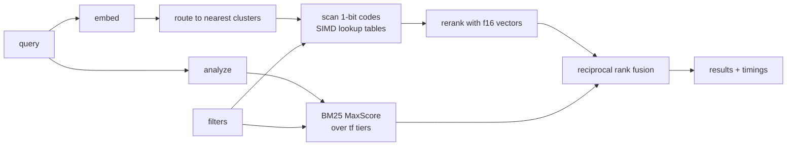

<p align="center">
  
</p>
<p align="center">
  <a href="#results">Results</a> · <a href="#how-a-query-runs">How it works</a> · <a href="#quick-start">Quick start</a> · <a href="#benchmarks">Benchmarks</a> · <a href="#datasets">Datasets</a>
</p>

---

 

*telusur* is Indonesian for "to search through, to trace". It is pronounced teh-LOO-soor.

 

I wanted to understand how a search engine built for AI actually works under the hood, so I took the designs Exa describes in its engineering blog and rebuilt them from scratch: their [vector database](https://exa.ai/blog/building-web-scale-vector-db), their [BM25 index](https://exa.ai/blog/bm25-optimization), and the [fusion step](https://exa.ai/blog/composing-a-search-engine) that joins them. Then I measured everything on real data.

 

One detail from Exa's vector DB post stuck with me: the lookup-table kernel at the core of it had to be written in C++ instead of Rust. telusur does it in Rust.

 

> Independent project. Not affiliated with or endorsed by Exa.

 

## Results

 

All numbers below come from the commands in [Benchmarks](#benchmarks), on the machines listed. <!-- fill from bench-results/ -->

 

**Machines:** an Apple M4 laptop (4 performance + 6 efficiency cores, 16 GB RAM) for everything, and an x86 cloud VM with AVX-512 (TBD) for the AVX2 and AVX-512 kernel rows.

 


|                                                          |                                       |
| -------------------------------------------------------- | ------------------------------------- |
| Codes scored per second, one core (256-dim, best kernel) | TBD                                   |
| Speedup over scalar                                      | TBD                                   |
| Recall@10 on 1M OpenAI embeddings                        | TBD at TBD ms p50                     |
| Hot memory per vector                                    | TBD bytes (vs 12,288 for raw float32) |
| BM25 nDCG@10 vs Anserini (avg of 4 BEIR sets)            | 45.72 vs 45.79                        |
| BM25 index size vs naive                                 | 87% smaller (BEIR NQ)                 |
| Postings decoded, MaxScore vs exhaustive                 | 50% fewer on TREC-COVID, same top-10  |
| Ingest throughput (FineWeb)                              | TBD docs/s (TBD docs/day)             |


 

## How a query runs

 



 

Keyword and neural retrieval run in parallel. Every response includes how long each stage took.

 

## The interesting parts

 

### 1. Scoring 1-bit codes against a float query, in registers

 

Documents are stored as the first 256 dims of a Matryoshka embedding, 1 bit per dim. That is 32 bytes per document instead of 12 KB.

 

The query stays in float. Split it into groups of 4 dims. A group of a binary document can only be one of 16 sign patterns, so for each query group I precompute all 16 possible partial dot products. Scoring a document is then one table lookup per 4 dims.

 

The fast part is doing those lookups 32 documents at a time. A byte shuffle (`vpshufb` on x86, `tbl` on ARM) is a 16-way parallel table lookup, so with the table in a register and 32 documents' nibbles in another, one instruction does 32 lookups. Codes are stored transposed in blocks of 32 so the nibbles line up.

 

There are four kernels (scalar, AVX2, AVX-512, NEON), picked at runtime. Every one is tested to match the scalar version bit for bit.

 


| Kernel  | Codes/s per core (256-dim) |
| ------- | -------------------------- |
| scalar  | TBD                        |
| AVX2    | TBD                        |
| AVX-512 | TBD                        |
| NEON    | TBD                        |


 

Why not Hamming distance? Keeping the query in float loses much less information. On the same codes:

 


| First-stage scorer                | Recall@100 (256-dim codes) |
| --------------------------------- | -------------------------- |
| Hamming (binary query)            | TBD                        |
| Asymmetric, float table           | TBD                        |
| Asymmetric, u8 table (what ships) | TBD                        |


 

### 2. Frequency tiers are impact tiers

 

Exa's BM25 post groups each term's postings by term frequency to save memory: all docs with tf=1 together, tf=2 together, and so on, so tf is stored once per group.

 

It turns out that grouping does a second job. Every doc in a tier has the same tf, so the tier's best possible score is known exactly. Treat each (term, tier) as its own list and run MaxScore over them, and the long tf=1 tiers of common words get skipped unless a document could still make the top k. Same top-k scores as scoring everything, and the bigger the corpus, the less decoding.

 

BEIR test queries, k = 10, Apple M4 ([B7](bench-results/b7-bm25-pruning-2026-11-05.md)). Each cell is exhaustive / MaxScore over tiers; latency is the keyword stage on one thread.


| Dataset    | Postings decoded per query | p50 ms        | p99 ms        | QPS, 1 thread   |
| ---------- | -------------------------- | ------------- | ------------- | --------------- |
| SciFact    | 4,376 / 4,103              | 0.066 / 0.047 | 0.090 / 0.119 | 14,936 / 20,312 |
| NFCorpus   | 671 / 671                  | 0.012 / 0.009 | 0.050 / 0.035 | 55,005 / 78,495 |
| FiQA       | 47,742 / 29,959            | 0.634 / 0.374 | 0.864 / 1.497 | 1,750 / 2,230   |
| TREC-COVID | 182,938 / 91,402           | 1.895 / 1.033 | 2.691 / 5.065 | 540 / 784       |

MaxScore wins on p50 and throughput everywhere, but loses p99 on long queries (9 to 20 terms), where every candidate probes many dense tiers. Block-max bounds inside tiers are the next step.


 

Memory, step by step (like Exa's post), on BEIR NQ: 2.68M docs, 118.6M postings, Apple M4 ([B8](bench-results/b8-ablate-postings-2026-11-05.md)). Each row counts postings, dictionary and doc lengths.

 


| Format                                            | Bytes per posting |
| ------------------------------------------------- | ----------------- |
| `HashMap<String, Vec<(u32, u32)>>`                | 12.69             |
| + one flat buffer                                 | 8.89              |
| + delta varint doc ids                            | 6.20              |
| + tf tiers                                        | 2.42              |
| + inline singletons, FST dictionary, 1-byte norms | 1.64              |

That is 87% smaller than naive. The delta varint row still keeps a 4-byte tf per posting; against a varint tf, tiers cut postings bytes by 34%.


 

### 3. Filters that act like a database

 

Filters (domain, crawl date range, any keyword field) are roaring bitmaps. If a filter is narrow, telusur skips the index and scores the matching docs exactly. If it is broad, it probes more clusters and drops non-matching docs before they reach the heap. Either way, no result ever breaks the filter.

 


| Selectivity | p50 | Recall@10 |
| ----------- | --- | --------- |
| 0.1%        | TBD | TBD       |
| 1%          | TBD | TBD       |
| 10%         | TBD | TBD       |
| 50%         | TBD | TBD       |


 

## Quick start

 

```bash
# build
cargo build --release

# try it on synthetic data (no downloads)
./target/release/telusur synth text --docs 100000 --out data/synth/corpus.jsonl
./target/release/telusur index --corpus data/synth/corpus.jsonl --out indexes/synth
./target/release/telusur search --index indexes/synth "w42 w1337"

# real data: BEIR SciFact with embeddings
python scripts/prep_beir.py scifact --model nomic-ai/nomic-embed-text-v1.5
./target/release/telusur index --corpus data/scifact/corpus.jsonl \
    --vectors data/scifact/corpus.fbin --out indexes/scifact
./target/release/telusur eval beir --data data/scifact --index indexes/scifact \
    --query-vectors data/scifact/queries.fbin

# serve it
python scripts/embed_server.py --model nomic-ai/nomic-embed-text-v1.5 &
./target/release/telusur serve --index indexes/scifact --embedder http://127.0.0.1:8001
curl -s localhost:8080/search -d '{"query":"does vitamin d prevent fractures","mode":"hybrid","k":5,"debug":true}'

```

 

## Benchmarks

 

Rules I hold myself to: release build, warm cache, single-thread latency over 1,000+ queries (p50 and p99), all-core throughput as QPS, the hardware printed with every run, and every comparison against another engine on the same machine. Raw outputs live in [`bench-results/`](bench-results/).

 


| What                        | Command                                                            |
| --------------------------- | ------------------------------------------------------------------ |
| Kernel throughput           | `cargo bench --bench kernels`                                      |
| First-stage scorer ablation | `telusur bench ablate-quant --base data/dbpedia/base.fbin ...`     |
| ANN recall vs latency       | `telusur bench ann --index indexes/dbpedia --queries ... --gt ...` |
| Filters                     | `telusur bench filters ...`                                        |
| BM25 quality                | `telusur eval beir --data data/<set> --index indexes/<set>`        |
| BM25 speed + memory         | `telusur bench bm25 ...` and `telusur bench ablate-postings ...`   |
| Ingest                      | `telusur ingest fineweb --parquet data/fineweb --out ...`          |


 

### BM25 quality (nDCG@10)

 


| Dataset    | Anserini BM25 | telusur BM25 | telusur neural | telusur hybrid |
| ---------- | ------------- | ------------ | -------------- | -------------- |
| SciFact    | 67.89         | 67.89        | TBD            | TBD            |
| NFCorpus   | 32.18         | 32.05        | TBD            | TBD            |
| FiQA       | 23.61         | 23.61        | TBD            | TBD            |
| TREC-COVID | 59.47         | 59.35        | TBD            | TBD            |


 

Anserini reference: the [BEIR (v1.0.0) flat BM25 regressions](https://github.com/castorini/anserini/tree/master/docs/reproduce/from-document-collection), k1=0.9, b=0.4. telusur's eval follows the same setup: title and text as one field, results matching the query id dropped, `trec_eval -c`. Measured on the Apple M4 ([B6](bench-results/b6-bm25-parity-2026-11-05.md)). Recall@100 matches Anserini on all four sets. NFCorpus and TREC-COVID are 0.13 and 0.12 below on nDCG@10, but plain Lucene 10.5 with the same setup lands where telusur does, so the gap is between today's Lucene and Anserini's reference run, which was recorded with Lucene 8.11 in 2022.

 

### ANN on 1M OpenAI embeddings

 


| nprobe | rerank depth | Recall@10 | p50 | p99 | QPS (4 / 10 threads) |
| ------ | ------------ | --------- | --- | --- | -------------------- |
| TBD    | TBD          | TBD       | TBD | TBD | TBD                  |


 

Compared with FAISS and hnswlib on the same machine: TBD.

 

## Datasets

 


| Dataset                                                                                                                                     | Used for                             | Size               |
| ------------------------------------------------------------------------------------------------------------------------------------------- | ------------------------------------ | ------------------ |
| [DBpedia 1M, OpenAI text-embedding-3-large](https://huggingface.co/datasets/Qdrant/dbpedia-entities-openai3-text-embedding-3-large-3072-1M) | ANN speed, recall, memory            | 24.8 GB            |
| [BEIR](https://github.com/beir-cellar/beir): SciFact, NFCorpus, FiQA, TREC-COVID                                                            | Retrieval quality                    | small to 171k docs |
| [FineWeb sample-10BT](https://huggingface.co/datasets/HuggingFaceFW/fineweb)                                                                | Ingest throughput, web-style filters | 27.6 GB            |
| Synthetic                                                                                                                                   | Tests and CI                         | generated          |


 

FineWeb is released under ODC-By 1.0 and is subject to Common Crawl's terms of use.

 

## Project layout

 

```
src/vector/   Matryoshka, binary codes, SIMD kernels, k-means, IVF, rerank
src/text/     analyzer, posting codecs, BM25 index and MaxScore
src/          filters, doc store, hybrid engine, HTTP server, eval, ingest
benches/      criterion benchmarks
scripts/      dataset prep and the embedding sidecar

```

 

## What I would do next

 

- Shard by cluster across processes and scatter-gather queries.
- Block-max bounds inside each tier.
- 2-bit codes or product quantization as an alternative first stage.
- A zstd cold tier for rarely used terms.

 

## Credits

 

The design follows Exa's engineering posts: [How we built a web-scale vector database](https://exa.ai/blog/building-web-scale-vector-db), [Serving BM25 with 50% memory reduction](https://exa.ai/blog/bm25-optimization), and [Composing a search engine](https://exa.ai/blog/composing-a-search-engine). BM25 settings follow Anserini. Benchmark file formats follow big-ann-benchmarks.

 

## License

 

MIT