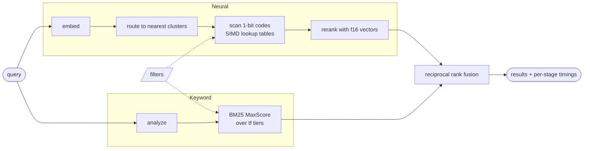

<p align="center">
  
</p>

<p align="center">
  <b>A hybrid search engine in Rust, built from scratch and measured on real data.</b>
</p>

<p align="center">
  
  
  
</p>

<p align="center">
  <a href="#results">Results</a> · <a href="#how-a-query-runs">How it works</a> · <a href="#the-interesting-parts">Deep dives</a> · <a href="#quick-start">Quick start</a> · <a href="#benchmarks">Benchmarks</a>
</p>

---

*telusur* (teh-LOO-soor) is Indonesian for "to search through, to trace".

It is the retrieval core of a modern search engine: a vector index that searches 1M embeddings in 0.45 ms from 1-bit codes, a BM25 index that scores like Lucene, and rank fusion with filters on top. I built it to see where the time and memory actually go, and measured every piece on real data: 1M OpenAI embeddings, four BEIR datasets and up to 3M web pages from FineWeb.

The heart of the vector search is a lookup-table kernel that does 32 table lookups per instruction with a byte shuffle. Kernels like this usually live in C++ (FAISS's fast scan is the best known). telusur's are Rust, for NEON, AVX2 and AVX-512, and each one is tested against a plain scalar version bit for bit.

## Results

Apple M4 laptop (4 performance + 6 efficiency cores, 16 GB RAM), one thread unless noted. Each number comes from a file in [`bench-results/`](bench-results/), linked from the sections below. The x86 kernel numbers are TBD until they run on a real x86 machine.

| | Metric | Result |
| --- | --- | --- |
| **Vector** | Recall@10 on 1M OpenAI embeddings | **0.952 at 0.45 ms** p50 (0.835 vs full vectors) |
| | vs hnswlib HNSW at recall@10 ≥ 0.95 | **1.8x faster** p50, half the index bytes |
| | Hot memory per vector | **37.2 bytes** (vs 12,288 for raw float32) |
| | Codes scored per second, one core | **516M** (256-dim, NEON), 11x scalar |
| **Keyword** | BM25 nDCG@10 vs Anserini, avg of 4 BEIR sets | **45.72** vs 45.79 |
| | BM25 vs Tantivy, same terms | **1.3x to 2.7x faster** p50, similar size |
| | Index size vs a naive inverted index | **87% smaller** (BEIR NQ and FineWeb 3M) |
| | Postings decoded, MaxScore vs exhaustive | **83% fewer** on FineWeb 3M, same top 10 |
| **Hybrid** | nDCG@10, avg of 4 BEIR sets | **56.60** (neural 56.14, BM25 45.72) |
| **Filters** | Neural search filtered to 1% of docs | **1.54x** the unfiltered latency, recall 1.000 |
| **Ingest** | FineWeb docs per second, one core | **73,346** (6.34B a day) |

## How a query runs



Keyword and neural retrieval run in parallel, so hybrid costs about as much as the slower of the two. Every response says how long each stage took.

## The interesting parts

### 1. Scoring 1-bit codes against a float query, in registers

Documents are stored as the first 256 dims of a Matryoshka embedding, 1 bit per dim. That is 32 bytes per document instead of 12 KB.

The query stays in float. Split it into groups of 4 dims. A group of a binary document can only be one of 16 sign patterns, so for each query group I precompute all 16 possible partial dot products. Scoring a document is then one table lookup per 4 dims.

The fast part is doing those lookups 32 documents at a time. A byte shuffle (`vpshufb` on x86, `tbl` on ARM) is a 16-way parallel table lookup, so with the table in a register and 32 documents' nibbles in another, one instruction does 32 lookups. Codes are stored transposed in blocks of 32 so the nibbles line up.

There are four kernels (scalar, AVX2, AVX-512, NEON), picked at runtime. Every one is tested to match the scalar version bit for bit.

| Kernel  | Codes/s per core (256-dim) |
| ------- | -------------------------- |
| scalar  | 46.3M (Apple M4)           |
| AVX2    | TBD                        |
| AVX-512 | TBD                        |
| NEON    | 516M (Apple M4)            |

Measured with `cargo bench --bench kernels` ([B1](bench-results/b1-kernels-2026-11-05.md)). The AVX2 and AVX-512 rows wait for an x86 run; on the Mac, NEON is 11x scalar at 256 and 512 dims.

Why not Hamming distance? Keeping the query in float loses much less information. On the same codes:

| First-stage scorer                | Recall@100 (256-dim codes) |
| --------------------------------- | -------------------------- |
| Hamming (binary query)            | 0.304                      |
| Asymmetric, float table           | 0.425                      |
| Asymmetric, u8 table (what ships) | 0.425                      |

200k DBpedia vectors, the true top 100 by cosine at 1024 dims, Apple M4 ([B2](bench-results/b2-ablate-quant-2026-11-05.md), 64 to 512 dims there). The float query finds 1.25x to 1.7x as many of the true neighbors as Hamming at every code size, and quantizing its tables to u8 costs nothing measurable.

### 2. Frequency tiers are impact tiers

A known way to shrink BM25 postings is to group each term's postings by term frequency: all docs with tf=1 together, tf=2 together, and so on, so tf is stored once per group.

It turns out that grouping does a second job. Every doc in a tier has the same tf, so the tier's best possible score is known exactly. Treat each (term, tier) as its own list and run MaxScore over them, and the long tf=1 tiers of common words get skipped unless a document could still make the top k. Same top-k scores as scoring everything, and the bigger the corpus, the less decoding.

BEIR test queries, plus BEIR NQ's queries against the 3M FineWeb docs, k = 10, Apple M4 ([B7](bench-results/b7-bm25-pruning-2026-11-05.md) for the setup; timings from the 7 Nov reruns in [B9](bench-results/b9-bm25-vs-tantivy-2026-11-07.md) and [FineWeb](bench-results/fineweb-3m-2026-11-07.md)). Each cell is exhaustive / MaxScore over tiers; latency is the keyword stage on one thread.

| Dataset    | Postings decoded per query | p50 ms        | p99 ms        | QPS, 1 thread   |
| ---------- | -------------------------- | ------------- | ------------- | --------------- |
| SciFact    | 4,376 / 4,103              | 0.034 / 0.022 | 0.049 / 0.053 | 28,877 / 39,235 |
| NFCorpus   | 671 / 671                  | 0.006 / 0.005 | 0.027 / 0.019 | 103,470 / 148,408 |
| FiQA       | 47,742 / 29,959            | 0.321 / 0.189 | 0.416 / 0.758 | 3,457 / 4,487   |
| TREC-COVID | 182,938 / 91,402           | 0.973 / 0.527 | 1.372 / 2.575 | 1,055 / 1,530   |
| FineWeb 3M | 2,729,739 / 475,726        | 17.03 / 2.39  | 24.99 / 13.96 | 60 / 315        |

The bigger the corpus, the more it skips: 50% of postings on TREC-COVID, 83% on FineWeb 3M, where it is 7.1x faster at p50. On three of the four BEIR sets it loses p99 on long queries (9 to 20 terms), where every candidate probes many dense tiers. On FineWeb it wins p99 too. Block-max bounds inside tiers are the next step.

Memory, step by step, on BEIR NQ (2.68M docs, 118.6M postings) and FineWeb 3M (581.8M postings), Apple M4 ([B8](bench-results/b8-ablate-postings-2026-11-05.md), [FineWeb](bench-results/fineweb-3m-2026-11-07.md)). Each row counts postings, dictionary and doc lengths.

| Format                                            | Bytes per posting, NQ | FineWeb 3M |
| ------------------------------------------------- | --------------------- | ---------- |
| `HashMap<String, Vec<(u32, u32)>>`                | 12.69                 | 12.48      |
| + one flat buffer                                 | 8.89                  | 8.71       |
| + delta varint doc ids                            | 6.20                  | 5.93       |
| + tf tiers                                        | 2.42                  | 2.20       |
| + inline singletons, FST dictionary, 1-byte norms | 1.64                  | 1.59       |

That is 87% smaller than naive on both (926 MB vs 7.26 GB on FineWeb). The delta varint row still keeps a 4-byte tf per posting; against a varint tf, tiers cut postings bytes by 34% (NQ) and 33% (FineWeb).

### 3. Filters that act like a database

Filters (domain, crawl date range, any keyword field) are roaring bitmaps. If a filter is narrow, telusur skips the index and scores the matching docs exactly. If it is broad, it probes more clusters and drops non-matching docs before they reach the heap. Either way, no result ever breaks the filter.

| Selectivity | p50 ms | Recall@10 | Path |
| ----------- | ------ | --------- | ---- |
| none        | 0.45   | 0.952     | 256 clusters |
| 0.1%        | 0.05   | 1.000     | exact |
| 1%          | 0.70   | 1.000     | exact |
| 10%         | 1.22   | 0.960     | 809 clusters |
| 50%         | 1.28   | 0.957     | 363 clusters |

DBpedia 1M with synthetic categories, neural search at the defaults, Apple M4 ([B5](bench-results/broad-filters-2026-11-10.md)). Recall is against the exact top 10 among the allowed docs.

- **1% takes 1.54x the unfiltered latency, within the 2x target.** It took 3.7x until the rerank dot product got its own NEON kernel and a prefetch ([#24](bench-results/rerank-speedup-2026-11-10.md)); the old one ran under 2 dims per cycle.
- **10% and 50% take 2.7x to 2.8x.** They took 6.6x to 7.8x before two fixes ([#25](bench-results/broad-filters-2026-11-10.md)). A filter on many values now builds its bitmap with one multi-way union instead of 500 one-by-one merges. And a broad filter probes `256 / sqrt(selectivity)` clusters instead of `256 / selectivity`, which probed every cluster at 10%. Filtered recall stays above unfiltered recall.

On real web data: neural and hybrid search on the FineWeb 1M index with NQ's queries, filtered by domain and crawl date ([B5](bench-results/broad-filters-2026-11-10.md)). Hybrid recall is against an exact hybrid: RRF over the exact keyword and neural top 100s with the same filter.

| Filter                 | Selectivity | Neural p50 ms | Recall@10 | Hybrid p50 ms | Recall@10 |
| ---------------------- | ----------- | ------------- | --------- | ------------- | --------- |
| none                   | 100%        | 0.62          | 0.940     | 2.16          | 0.896     |
| the biggest domain     | 0.11%       | 0.05          | 1.000     | 2.14          | 1.000     |
| the 20 biggest domains | 1.02%       | 0.47          | 0.999     | 2.30          | 1.000     |
| one day of crawl       | 0.10%       | 0.04          | 1.000     | 1.74          | 1.000     |
| two days of crawl      | 1.00%       | 0.41          | 1.000     | 2.19          | 1.000     |
| a year of crawl        | 10.0%       | 1.90          | 0.971     | 2.07          | 0.915     |
| six years of crawl     | 50.0%       | 1.05          | 0.951     | 2.17          | 0.902     |

No result left its filter. At 1% both modes are within the 2x target: neural takes 0.65x to 0.75x of unfiltered, hybrid 1.01x to 1.06x. Most of hybrid's time is the keyword stage, which a filter barely changes. This index uses 512-dim codes; with 256 its unfiltered neural recall was 0.822 (see [ANN](#ann-on-1m-openai-embeddings)).

<details>
<summary><b>Keyword search with the same filters, on FineWeb 3M</b></summary>

<br>

FineWeb 3M with NQ's queries ([B5](bench-results/fineweb-3m-2026-11-07.md)):

| Filter                 | Selectivity | p50 ms | vs none |
| ---------------------- | ----------- | ------ | ------- |
| none                   | 100%        | 2.73   | 1.00x   |
| the biggest domain     | 0.13%       | 2.95   | 1.08x   |
| the 18 biggest domains | 1.03%       | 3.55   | 1.30x   |
| 20 days of crawl       | 0.10%       | 1.67   | 0.61x   |
| a year of crawl        | 1.00%       | 2.04   | 0.75x   |
| 3 months of crawl      | 10.0%       | 2.63   | 0.97x   |
| 4.4 years of crawl     | 50.0%       | 2.92   | 1.07x   |

Filtered MaxScore returns the same top 10 as filtered exhaustive search on every query. Narrow date ranges beat no filter: FineWeb's crawl dates come in runs along doc id order, and each MaxScore window starts at the next doc the filter allows, so cursors skip whole runs. A date range is the union of a few precomputed blocks of days, so even 50% costs little to build. Before that change, 20 days of crawl took 2.96x and 4.4 years 2.42x. This run was on battery, which is why "none" is slower than in the BM25 table above.

</details>

## How it stays correct

Every fast path has a slow, obviously correct twin, and a test that compares them:

- **SIMD kernels** match the scalar kernel bit for bit, at 64 to 1024 dims and ragged block sizes, and so do the f16 rerank kernels. The tests run here with NEON, and with AVX2 under Rosetta.
- **MaxScore** returns the same top-k scores as exhaustive BM25, for k of 1, 10 and 100, with and without filters.
- **BM25** matches a hand-written Lucene formula, and the analyzer is checked against Lucene's output and the official Porter stemmer vocabulary.
- **Filters** never return a doc outside the filter, in any mode.
- **Fusion and metrics:** RRF matches hand-computed scores, and nDCG and recall match pytrec_eval.

`unsafe` lives only in the kernels and the mmap helpers, each block with a comment saying why it stays in bounds. Every number in this README comes from a file in [`bench-results/`](bench-results/) that records the command and the machine, and anything not measured yet says TBD.

## Quick start

You need stable Rust, and [uv](https://docs.astral.sh/uv/) for the Python data scripts. Builds target the local CPU (`.cargo/config.toml`), so don't copy the binary to another machine.

**Try it without downloading anything** (synthetic data):

```bash
cargo build --release
./target/release/telusur synth text --docs 100000 --out data/synth/corpus.jsonl
./target/release/telusur index --corpus data/synth/corpus.jsonl --out indexes/synth
./target/release/telusur search --index indexes/synth "w42 w1337"
```

**Real data: BEIR SciFact with embeddings**

```bash
uv run --with fastembed scripts/prep_beir.py scifact --model nomic-ai/nomic-embed-text-v1.5
./target/release/telusur index --corpus data/scifact/corpus.jsonl \
    --vectors data/scifact/corpus.fbin --out indexes/scifact
./target/release/telusur eval beir --data data/scifact --index indexes/scifact \
    --query-vectors data/scifact/queries.fbin
```

**Serve it over HTTP**

```bash
uv run --with fastembed scripts/embed_server.py --model nomic-ai/nomic-embed-text-v1.5 &
./target/release/telusur serve --index indexes/scifact --embedder http://127.0.0.1:8001 &
curl -s localhost:8080/search -d '{"query":"does vitamin d prevent fractures","mode":"hybrid","k":5,"debug":true}'
```

**Web data with filters: 1M FineWeb docs** (the embed took 58 hours on a laptop CPU)

```bash
./target/release/telusur ingest fineweb --parquet data/fineweb --out data/fineweb/corpus-1m.jsonl --limit 1000000
uv run --with fastembed scripts/embed_corpus.py data/fineweb/corpus-1m.jsonl data/fineweb/corpus-1m.fbin \
    --limit 1000000 --max-tokens 512
uv run --with fastembed scripts/embed_corpus.py data/nq/queries.jsonl data/fineweb/nq-queries.fbin --queries
./target/release/telusur index --corpus data/fineweb/corpus-1m.jsonl --vectors data/fineweb/corpus-1m.fbin \
    --out indexes/fineweb-neural --keyword-fields domain --date-field crawl_date --d-code 512

# a filter is any of a field's values, or an inclusive crawl date range (either end open)
./target/release/telusur search --index indexes/fineweb-neural --mode hybrid \
    --query-vectors data/fineweb/nq-queries.fbin --query-row 0 \
    --filter domain=investopedia.com,accountingtools.com --filter crawl_date=2019-01-01.. \
    "what is non controlling interest on balance sheet"
./target/release/telusur serve --index indexes/fineweb-neural --embedder http://127.0.0.1:8001 \
    --addr 127.0.0.1:8081 &
curl -s localhost:8081/search -d '{"query":"what is non controlling interest on balance sheet","mode":"hybrid",
    "filters":{"domain":["investopedia.com","accountingtools.com"],"crawl_date":{"gte":"2019-01-01"}}}'
```

## Benchmarks

Rules I hold myself to: release build, warm cache, single-thread latency over 1,000+ queries (p50 and p99), all-core throughput as QPS, the hardware printed with every run, and every comparison against another engine on the same machine. Raw outputs live in [`bench-results/`](bench-results/).

| What                        | Command                                                            |
| --------------------------- | ------------------------------------------------------------------ |
| Kernel throughput           | `cargo bench --bench kernels`                                      |
| First-stage scorer ablation | `telusur bench ablate-quant --base data/dbpedia/base.fbin ...`     |
| ANN recall vs latency       | `telusur bench ann --index indexes/dbpedia --queries ... --gt ...` |
| ANN vs FAISS and hnswlib    | `scripts/compare_faiss.py data/dbpedia`                            |
| Filters                     | `telusur bench filters ...`                                        |
| Filters on web data         | `telusur bench keyword-filters ...` and `bench hybrid-filters ...` |
| BM25 quality                | `telusur eval beir --data data/<set> --index indexes/<set>`        |
| Keyword, neural, hybrid quality | `telusur eval beir ... --query-vectors data/<set>/queries.fbin` |
| HTTP latency per stage      | `telusur bench http --queries ...` against `telusur serve`         |
| BM25 speed + memory         | `telusur bench bm25 ...` and `telusur bench ablate-postings ...`   |
| BM25 vs Tantivy             | `telusur-tantivy index ...` and `bench ...` (in `compare/tantivy`) |
| Ingest                      | `telusur ingest fineweb --parquet data/fineweb --out ...`          |

### Search quality (nDCG@10)

| Dataset    | Anserini BM25 | telusur BM25 | telusur neural | telusur hybrid |
| ---------- | ------------- | ------------ | -------------- | -------------- |
| SciFact    | 67.89         | 67.89        | 70.33          | **73.85**      |
| NFCorpus   | 32.18         | 32.05        | 34.56          | **35.83**      |
| FiQA       | 23.61         | 23.61        | **37.48**      | 35.24          |
| TREC-COVID | 59.47         | 59.35        | **82.19**      | 81.50          |

Anserini reference: the [BEIR (v1.0.0) flat BM25 regressions](https://github.com/castorini/anserini/tree/master/docs/reproduce/from-document-collection), k1=0.9, b=0.4. telusur's eval follows the same setup: title and text as one field, results matching the query id dropped, `trec_eval -c`. Measured on the Apple M4 ([B6](bench-results/b6-bm25-parity-2026-11-05.md)). Recall@100 matches Anserini on all four sets. NFCorpus and TREC-COVID are 0.13 and 0.12 below on nDCG@10, but plain Lucene 10.5 with the same setup lands where telusur does, so the gap is between today's Lucene and Anserini's reference run, which was recorded with Lucene 8.11 in 2022.

Neural uses nomic-embed-text-v1.5 on CPU (768 dims), searched at the index defaults. Hybrid is RRF over the top 1000 of each ([B10](bench-results/b10-hybrid-beir-2026-11-06.md)). Hybrid beats the better single mode on SciFact and NFCorpus, where BM25 and neural are close. It falls a little behind neural on FiQA and TREC-COVID, where BM25 is 14 and 23 points worse. That misses the PRD target of 3 of 4 sets. Its average (56.60) is still the best of the three modes (neural 56.14, BM25 45.72).

### BM25 vs Tantivy

Tantivy 0.27 on the same machine, fed through telusur's analyzer so both index the same terms: one field, no positions, one segment ([B9](bench-results/b9-bm25-vs-tantivy-2026-11-07.md)). Each cell is telusur / Tantivy. Index bytes are postings, dictionary and doc lengths.

| Dataset    | p50 ms        | p99 ms        | QPS, 1 thread    | Index bytes       |
| ---------- | ------------- | ------------- | ---------------- | ----------------- |
| SciFact    | 0.022 / 0.058 | 0.053 / 0.241 | 39,234 / 13,704  | 1.23 MB / 1.17 MB |
| NFCorpus   | 0.005 / 0.007 | 0.019 / 0.060 | 148,407 / 83,930 | 0.92 MB / 0.88 MB |
| FiQA       | 0.189 / 0.353 | 0.758 / 1.747 | 4,487 / 2,175    | 6.23 MB / 6.47 MB |
| TREC-COVID | 0.527 / 0.816 | 2.575 / 5.703 | 1,529 / 969      | 22.4 MB / 23.4 MB |
| FineWeb 3M | 2.39 / 3.12   | 13.96 / 25.86 | 315 / 198        | 926 MB / 1,005 MB |

On the small sets the gap is mostly per-query overhead: even telusur's exhaustive search beats Tantivy there. FineWeb tests the pruning: Tantivy's block-max WAND cuts exhaustive search from 17.03 ms to 3.12, and MaxScore over tiers gets it to 2.39, with half Tantivy's p99. The two engines don't score the same: Tantivy fixes BM25 at k1 1.2, b 0.75, against Anserini's 0.9 and 0.4. So 62% to 87% of their top 10s match, and each prunes against its own scores.

### ANN on 1M OpenAI embeddings

DBpedia 1M, OpenAI text-embedding-3-large (3072 dims), 2,048 clusters, 256-dim codes, 1024-dim rerank vectors, Apple M4 ([B3](bench-results/b3-ann-dbpedia-2026-11-05.md), full grid there; rerun on 10 Nov after [#24](bench-results/rerank-speedup-2026-11-10.md)). Recall@10 against rerank ground truth (exact top 10 at the rerank dims) and full ground truth (at all 3072 dims); latency on one thread.

| Clusters probed | Rerank depth | Recall@10 (rerank / full GT) | p50 ms | p99 ms | QPS (4 / 10 threads) |
| --------------- | ------------ | ---------------------------- | ------ | ------ | -------------------- |
| 32              | 0            | 0.457 / 0.441                | 0.07   | 0.08   | 47,337 / 75,497      |
| 32              | 200          | 0.839 / 0.754                | 0.12   | 0.14   | 29,746 / 44,267      |
| 128             | 200          | 0.894 / 0.800                | 0.23   | 0.27   | 15,186 / 23,535      |
| 128             | 500          | 0.932 / 0.821                | 0.31   | 0.34   | 11,644 / 18,475      |
| 256 (default)   | 500          | 0.952 / 0.835                | 0.45   | 0.49   | 7,633 / 12,005       |
| 512             | 1000         | 0.976 / 0.849                | 0.84   | 0.99   | 4,062 / 6,450        |

The defaults, 256 clusters probed and a rerank depth of 500, are the smallest that reach 0.95 against rerank ground truth; at depth 200 recall stops near 0.92 however many clusters are probed. Against full ground truth recall tops out near 0.85: that is the cost of reranking with 1024 of the 3072 dims. QPS at 10 threads is noisy on a laptop with other apps open.

The right code size depends on the embedding model. On FineWeb 1M with nomic-embed-text-v1.5 (768 dims) and NQ questions as queries, 256-dim codes reach only 0.822 at the defaults. Probing every cluster barely helps (0.828), and the 256-dim codes find 28% of the true top 100 against 42.5% on DBpedia. So the first stage is what loses recall. 512-dim codes reach 0.940 at the defaults and win at every latency, for 74 instead of 39 hot bytes per vector, so the FineWeb index uses them ([details](bench-results/fineweb-recall-2026-11-10.md)).

Against FAISS and hnswlib on the same machine, each at the cheapest setting that reaches recall@10 ≥ 0.95, given the same 1024-dim vectors, all in one session ([B4](bench-results/b4-ann-vs-others-2026-11-10.md)):

| Engine                            | Recall@10 | p50 ms | QPS, 10 threads | Index bytes         |
| --------------------------------- | --------- | ------ | --------------- | ------------------- |
| **telusur**                       | 0.952     | **0.44** | **12,491**    | 2.09 GB (39 MB hot) |
| hnswlib HNSW (M 16, ef 64)        | 0.959     | 0.82   | 6,733           | 4.24 GB             |
| FAISS IndexIVFFlat (128 lists)    | 0.972     | 4.29   | 352             | 4.11 GB             |
| FAISS IndexBinaryIVF + rerank 500 | 0.868 max | 0.62   |                 | 4.13 GB             |

Only telusur's codes, ids and centroids (39 MB) need to stay in RAM; the f16 rerank vectors are memory-mapped and read for 500 candidates per query. The FAISS binary row is telusur's design with Hamming distance in place of the float-query scan. It never reaches 0.95, even probing 512 clusters. hnswlib has hand-written SIMD only for x86, so this ARM run probably understates it.

### HTTP latency

One client, one request at a time over localhost, k = 10, 1,000 requests per mode, Apple M4, 7 Nov ([B12](bench-results/b12-http-2026-11-07.md), per-stage split there). On DBpedia 1M the request carries the query vector. On TREC-COVID the server embeds the query text through the nomic sidecar on CPU.

| Mode    | DBpedia 1M p50 / p99 ms | TREC-COVID, server embeds, p50 / p99 ms |
| ------- | ----------------------- | --------------------------------------- |
| keyword | 0.16 / 0.75             | 0.60 / 2.55                             |
| neural  | 0.75 / 0.82             | 11.55 / 18.18                           |
| hybrid  | 0.79 / 1.16             | 12.28 / 22.91                           |

HTTP and JSON add 0.1 to 0.2 ms, and the server's neural search runs at in-process speed. Hybrid costs about the same as neural, because the keyword search runs in parallel. When the server embeds, the embedder is over 90% of the time (10.7 ms p50), and the search itself takes under 1 ms.

## Datasets

| Dataset                                                                                                                                     | Used for                             | Size               |
| ------------------------------------------------------------------------------------------------------------------------------------------- | ------------------------------------ | ------------------ |
| [DBpedia 1M, OpenAI text-embedding-3-large](https://huggingface.co/datasets/Qdrant/dbpedia-entities-openai3-text-embedding-3-large-3072-1M) | ANN speed, recall, memory            | 24.8 GB            |
| [BEIR](https://github.com/beir-cellar/beir): SciFact, NFCorpus, FiQA, TREC-COVID                                                            | Retrieval quality                    | small to 171k docs |
| [FineWeb sample-10BT](https://huggingface.co/datasets/HuggingFaceFW/fineweb)                                                                | Ingest, BM25 at 3M docs, web filters | 27.6 GB            |
| Synthetic                                                                                                                                   | Tests and speed checks               | generated          |

FineWeb is released under ODC-By 1.0 and is subject to Common Crawl's terms of use.

<details>
<summary><b>Why FineWeb is 3M docs for keyword search, and 1M for neural</b></summary>

<br>

FineWeb is used at N = 3M docs: the first three of its parquet files. The keyword build is one pass in memory, and probe builds of 1M and 2M docs measured about 2.4 GB of peak memory per million docs. 3M (6.93 GB measured) fits a 16 GB laptop next to everything else; 4M (about 10 GB) would not ([details](bench-results/fineweb-3m-2026-11-07.md)). Past that, the build would need segments and a merge.

Neural and hybrid search on FineWeb use a second index, over the first 1M of those docs. Embedding is the slow part. The 3M keyword build takes 427 s, but embedding 1M docs with nomic-embed-text-v1.5 on this laptop's CPU took 58 hours, about 2 hours per 50k docs plus a night asleep ([log](bench-results/fineweb-neural-build-2026-11-10.txt)). And an index never changes once built, so every doc in it has a vector or none do ([ADR 0001](docs/adr/0001-indexes-are-immutable.md)). So the embedded docs get their own full index (keyword, vectors and filters) instead of vectors on a third of the 3M one.

</details>

## Project layout

```
src/vector/   Matryoshka, binary codes, SIMD kernels, k-means, IVF, rerank
src/text/     analyzer, posting codecs, BM25 index and MaxScore
src/          filters, doc store, hybrid engine, HTTP server, eval, ingest
benches/      criterion benchmarks
scripts/      dataset prep and the embedding sidecar
```

## What I would do next

- Shard by cluster across processes and scatter-gather queries.
- Block-max bounds inside each tier.
- 2-bit codes or product quantization as an alternative first stage.
- A zstd cold tier for rarely used terms.

## References

Ideas telusur builds on:

- Kusupati et al., *Matryoshka Representation Learning*, NeurIPS 2022.
- Jégou, Douze and Schmid, *Product Quantization for Nearest Neighbor Search*, TPAMI 2011 (the IVF index).
- André, Kermarrec and Le Scouarnec, *Cache Locality is not Enough: High-Performance Nearest Neighbor Search with Product Quantization Fast Scan*, VLDB 2015 (lookup tables in SIMD registers).
- Turtle and Flood, *Query Evaluation: Strategies and Optimizations*, Information Processing & Management, 1995 (MaxScore).
- Cormack, Clarke and Büttcher, *Reciprocal Rank Fusion Outperforms Condorcet and Individual Rank Learning Methods*, SIGIR 2009.
- Chambi, Lemire, Kaser and Godin, *Better Bitmap Performance with Roaring Bitmaps*, Software: Practice and Experience, 2016.
- Engineering write-ups on [a web-scale vector database](https://exa.ai/blog/building-web-scale-vector-db), [BM25 memory reduction](https://exa.ai/blog/bm25-optimization) and [composing a search engine](https://exa.ai/blog/composing-a-search-engine), from Exa's engineering blog.

BM25 settings and the BEIR eval follow [Anserini](https://github.com/castorini/anserini). Benchmark file formats follow [big-ann-benchmarks](https://github.com/harsha-simhadri/big-ann-benchmarks).

## License

[MIT](LICENSE)
